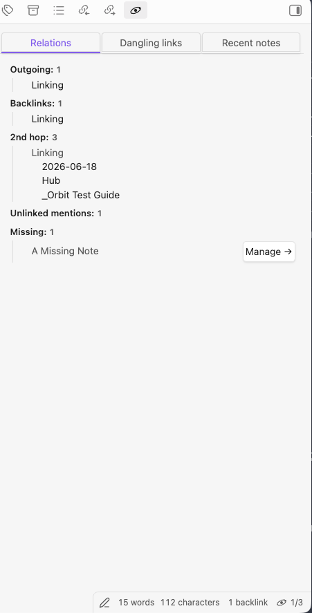
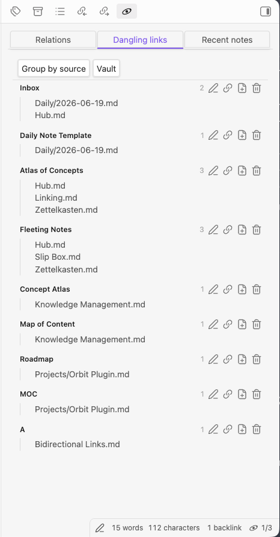
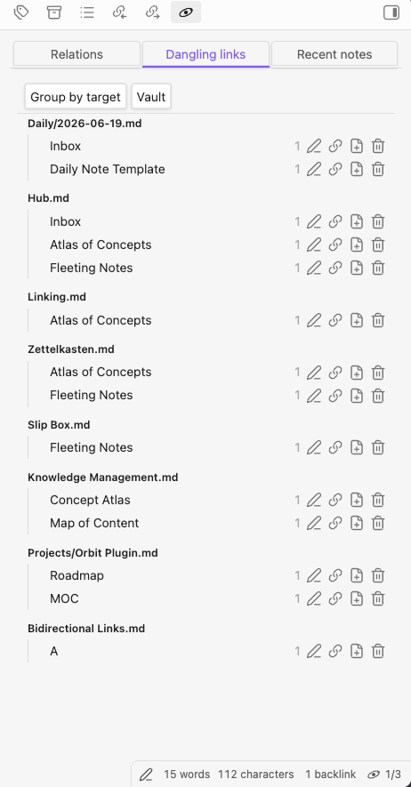
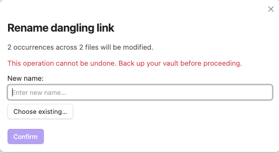
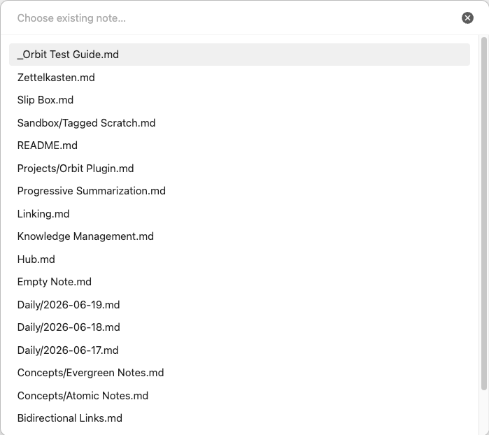
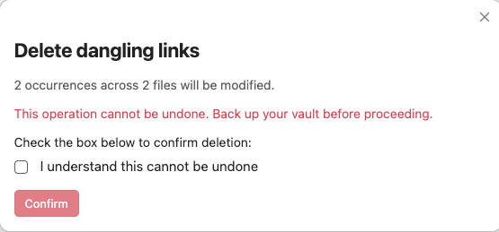
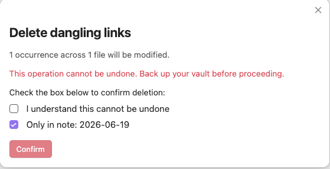
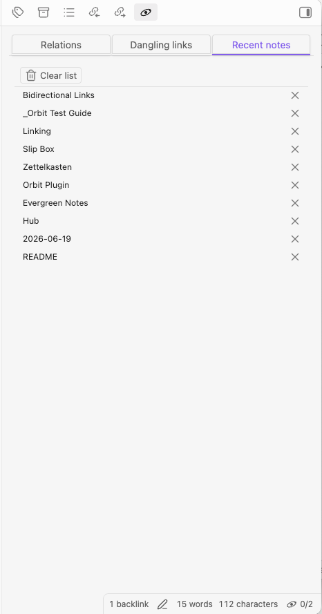

# Usage

Orbital puts four sidebar workflows — context, relations, dangling links, and recent
notes — into a single pane. This page walks through opening the pane and the everyday
tasks you'll repeat.

## First use

Open the pane with the **Orbital: Open** command from the command palette
(`Cmd/Ctrl-P`). It docks in the right sidebar as one pane with four tabs:
**Context**, **Relations**, **Dangling links**, and **Recent notes**. Each tab has an
icon; when the pane is narrow the labels collapse to icons only.



Every tab reflects the **active note** and updates as you switch notes (debounced, so
rapid switching doesn't flicker).

## Common workflows

### Context tab

The **Context tab** is the first tab and opens by default. It shows the active note's
**backlinks with the surrounding text**, so you can see at a glance where the note
you're reading shows up — like Obsidian's "Linked mentions", kept inside Orbital.


Each source note is a group showing its name, how many times it links here, and a
snippet of the line(s) where the link appears (with the link highlighted). Click a
snippet to open that note at that line; Mod-click opens it in a new tab.

A toolbar across the top mirrors Obsidian's Linked-mentions:

- **Collapse all** — fold / unfold every source group.
- **Sort** — cycles **recently modified → mention count → name**.
- **Style** — toggles **dense** (compact) and **cards** (bordered) layout.
- **Search** — filter the sources by note name.

How much text each snippet shows is the **Context amount** setting (Compact /
Comfortable / Full line / Surrounding lines) — see
[Settings → Context tab](settings-reference.md#context-tab). The style, sort, and
collapse defaults live there too; the toolbar overrides them for the session.

The Context tab is the read-only reference for "where does this note appear"; the
other tabs are for working through and fixing your links.

### Explore a note's relations

The Relations tab groups everything connected to the active note:

- **Outgoing** — links this note makes to others.
- **Backlinks** — notes that link back to this one.
- **2nd hop** — related notes one step further out, deduplicated and excluding notes
  you already link directly.
- **Unlinked mentions** — notes that mention this note's name (or an alias) in plain
  text without linking it. Collapsed by default; expand it to scan on demand.
- **Missing** — unresolved link targets in this note. Use **Manage →** to jump to the
  Dangling links tab pre-filtered to those targets.

Click a row to open it in the current pane; Mod-click (or middle-click) opens it in a
new tab.

### Fix dangling links in bulk

The Dangling links tab lists unresolved link targets. Switch the scope between
**Vault** and the active note's folder, and toggle grouping between **target** and
**source**. The search box to the right of the scope toggle fuzzy-filters the list
by target name or source path as you type.





> These actions edit the **dangling link's text inside your notes** — they don't touch
> a target file. There is no target note to begin with (the link is unresolved), so
> **Create note** is the only action that ever creates a file, and nothing here deletes
> a note.

Each row offers four actions — **rename**, **change to alias**, **create note**, and
**delete**:

- **Rename** rewrites every reference to a new target. If the new name matches an
  existing note or spelling, the references merge onto it. A preview shows how many
  occurrences across how many files will change.

  

- **Change to alias** replaces the broken link with an alias pointing at an existing
  note you pick from a fuzzy list.

  

- **Create note** creates a note for the target (in the folder set in your settings)
  and resolves the references.
- **Delete** unwraps the link, leaving its text as plain text in your notes
  (`[[Inbox]]` → `Inbox`, `[[Inbox|capture]]` → `capture`). It does **not** delete any
  note. From the **source** grouping you can scope this to a single note.

  

  

Every write operation is preview-confirmed and **cannot be undone** — back up your
vault first, as each dialog warns.

### Browse recent notes

The Recent notes tab is a most-recent-first list of opened notes.



Click a row to open it (Mod-click for a new tab), drag a row into an editor to insert
a `[[wikilink]]` at the drop point, remove a single entry with its **×**, or
**Clear list** to empty it. The list length and folder/tag exclusions are configurable
(see below).

### In-note backlinks (`orbital-backlinks`)

An `orbital-backlinks` code block renders the **containing note's** backlinks inline, in reading view and live preview. Drop it anywhere in a note to see which other notes link to it, without opening the Relations sidebar. The block updates automatically as links across the vault change.

<!-- #54 — capture assets/orbital-innote-backlinks.png from the test vault, then
     delete these two comment lines to publish the image.

-->

#### Creating the block

An empty block works immediately with no configuration:

````markdown
```orbital-backlinks
```
````

#### Config keys

All keys are optional. Omit any key to use its default.

| Key | Values | Default |
|-----|--------|---------|
| `display` | `compact` or `context` | `compact` |
| `folder` | comma-separated folder paths | _(no constraint)_ |
| `folder-exclude` | comma-separated folder paths | _(none)_ |
| `tag` | comma-separated tags (`#` optional) | _(no constraint)_ |
| `tag-exclude` | comma-separated tags (`#` optional) | _(none)_ |
| `style` | `dense` or `cards` (context only) | _(the **Context style** setting)_ |
| `collapse` | `true` or `false` (context only) | _(the **Collapse context by default** setting)_ |

**`display`** — `compact` (default) shows one clickable title per source note. `context` shows the text surrounding each link; see [Display modes](#display-modes) below.

**`style`** — context-mode visual style: `dense` (compact list with a vertical rule) or `cards` (one bordered card per source). Overrides the **Context style** setting for this block. Ignored in compact mode.

**`collapse`** — `true` starts each context group folded; `false` starts them expanded. Overrides the **Collapse context by default** setting for this block. Ignored in compact mode.

**`folder` / `folder-exclude`** — match on path-segment boundaries, subfolders included. `Research` matches `Research/paper.md` but not `Researchers/x.md`. Supply a comma-separated list to match multiple folders.

**`tag` / `tag-exclude`** — nested-tag aware. `tag: #active` matches notes tagged `#active` or `#active/now`. Matches both inline and frontmatter tags. The leading `#` is optional in the config.

Two plugin settings under **Settings → Orbital → In-note backlinks** set the
context-mode defaults (**Context style** and **Collapse context by default**);
every other option lives in the block's markdown source. A block's `style:` /
`collapse:` keys override those settings.

#### Display modes

**Compact** (default): one clickable title per source note, uncapped. Click to open the note; Mod-click (Cmd/Ctrl) opens it in a new tab. Hover with the Page preview core plugin enabled for a preview popover.

**Context**: under each source note the block shows a windowed snippet (~90 characters on each side) of the line where the link appears, with the link text highlighted.

- Each source shows a **chevron**, its title, and the **number of times it links to this note** (right-aligned, like Obsidian's Linked mentions). Click the chevron or title to fold/unfold that group; start folded with `collapse: true` (or the setting).
- **Click a context line to open** the source note scrolled to that line. Mod-click opens it in a new tab.
- Choose the look with `style: dense` (default) or `style: cards` (or the **Context style** setting).
- If a source note links to the containing note on **two different lines**, you see two snippets under that source.
- If two links to the containing note appear on the **same line**, the line is shown once with both occurrences highlighted.
- Context mode is soft-capped at **50 source notes**; if more exist, a "… and N more" notice appears at the end of the block.

An unrecognised `display`, `style`, or `collapse` value falls back to the default and shows an inline warning.

#### Filter precedence

Multiple values within a key are OR'd — `folder: Projects, Areas` matches sources in either folder.

Filters across different keys are AND'd — `folder: Projects` combined with `tag: #active` shows only sources that are inside Projects **and** carry `#active`.

**Exclude keys always win.** A source matched by `folder-exclude` or `tag-exclude` is hidden regardless of what the include keys say.

Concrete example: a block with `folder: a/b` and `folder-exclude: a` — a source at `a/b/note.md` satisfies the include (it is inside `a/b`), but the exclude wins (it is a subfolder of `a`), so the source is hidden.

Orbital's global exclusion settings (path/tag patterns in **Settings → Orbital → Advanced**) are applied on top of, and independently of, the block's own filters.

#### Limitations

- The block always shows backlinks to the note it lives in; there is no way to target a different note.
- No second-hop (transitive) relations.
- No sort or limit options; sources appear in index order.
- Fold state is per-block and is not persisted across reloads.

#### Example

````markdown
```orbital-backlinks
display: context
folder: Projects, Areas
tag: #active
tag-exclude: #draft
```
````

This block shows backlinks from notes inside `Projects` or `Areas`, tagged `#active` (or any nested tag such as `#active/now`), excluding any that also carry `#draft`. Each source displays the line of text where the link appears, with the link highlighted.

### Backlinks footer

Rather than adding an `orbital-backlinks` block to each note by hand, enable
**Settings → Orbital → In-note backlinks → Show backlinks footer** to append the
backlinks view automatically at the end of **every** note — in both reading view
and live preview, separated from the note body by a divider (like Obsidian's
own "Backlinks in document").

<!-- #54 — capture assets/orbital-backlinks-footer.png from the test vault, then
     delete these two comment lines to publish the image.

-->

- The footer always uses **context** mode and follows the **Context style**
  (dense/cards) and **Collapse context by default** settings.
- It shows `Backlinks: 0` and **No backlinks.** on notes with none, so you can
  always see it is active.
- Notes matched by the global exclusion settings (**Settings → Orbital →
  Advanced**) get no footer.
- It updates live as links across the vault change, and disappears cleanly the
  moment you turn the setting off.

The footer is **off by default**. It is independent of any `orbital-backlinks`
code block — if a note has both, both render.

## Tips and shortcuts

- **Mod-click / middle-click** any relation or recent row to open it in a new tab.
- **Hover** a row with the core *Page preview* plugin enabled to get a preview popover.
- **Status bar:** the Orbital item shows backlink / 2nd-hop counts for the active note —
  click it to open the Orbital pane. Toggle it in settings.
- **Manage →** in the Missing section deep-links to the Dangling links tab filtered to
  that target; **Show all** restores the full list.
- Choose the default tab, count badges, exclusions, and more under **Settings → Orbital**.

## See also

- [Configuration](configuration.md) — every setting Orbital exposes.
- [Troubleshooting](troubleshooting.md) — common issues and how to get help.
